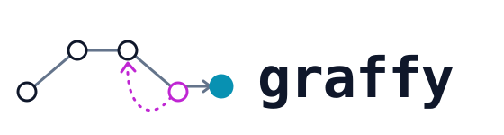

<div align="center">

<picture>
  <source media="(prefers-color-scheme: dark)" srcset="assets/graffy-logo-dark.svg">
  
</picture>

# graffy

**A terminal-native runtime for inspectable, durable agent graphs.**

Every prompt, chat message, imported skill, tool call, and approval runs through a compiled TOML graph and produces an append-only run journal.

[](https://github.com/rainmana/graffy/actions/workflows/ci.yml)
[](https://github.com/rainmana/graffy/releases)
[](LICENSE)
[](rust-toolchain.toml)
[](#install-a-release-binary)
[](https://ratatui.rs)
[](https://github.com/rainmana/mcw-framework)

*Pre-alpha (source-tree version `0.1.0-alpha.7`; tagged releases may trail it). The graph runtime, journals, terminal chat, prompt routing, TUI, providers, MCP facades, graphification, persistence, retries, and metrics work; several larger MCW, memory, agent, and evaluation features remain in development.*

</div>

## At a glance

```console
$ graffy chat --offline --route
routing : on — may choose 'Decision Framework', 'Sequential Thinking'. Start a message with /chat to use plain conversation instead.

you> what are the pros and cons of renting?
routing : running 'Decision Framework' because your message says "pros and cons"
  · step: intake
  · step: ground
  · step: frame
  · step: evaluate
  · step: challenge
  · step: decide
  · step: respond

================ response (not model-reviewed) ================
[offline echo — no real model was consulted]
what are the pros and cons of renting?
details : graffy replay "~/.graffy/runs/<run-id>.journal" --tui
```

That is a plain-terminal chat turn (start-up lines trimmed, journal path shortened). The message was routed onto a registered graph by a rule you can read, the graph ran step by step, and the answer was released with an honest label. `--offline` swaps the model for a deterministic echo, so this works with no keys and no network. Add `--tui` for the full-screen conversation view.

## Why graffy?

Most agent harnesses treat the prompt as the program and leave orchestration hidden inside application code. graffy makes the orchestration a first-class artifact:

- **Graphs are data.** Nodes, edges, guards, budgets, evidence policy, and model-routing tiers live in readable TOML files that can be diffed, versioned, exported, and imported.
- **Runs are inspectable records.** Every run writes length-delimited protobuf events to an append-only `.journal` file and mirrors completed runs into embedded libSQL. `replay` folds those recorded events for inspection; it does not re-execute the graph.
- **Loops are bounded.** The compiler rejects unguarded cycles; the executor enforces visit caps and deadlines, requests remaining output-token ceilings, and stops on recorded budget exhaustion. Input token use and unpriced USD costs have limits described below.
- **Quality gates route visibly.** `verify` nodes return `PASS` or `REVISE`; revisions emit failure signals and move subsequent work up the graph's routing ladder.
- **Tools are graph nodes.** MCP tools are discovered over stdio and wrapped in generated facade graphs. Destructive or unannotated tools receive a human approval gate by default.
- **Human decisions are journaled.** Approvals show exact payloads and preserve decision input. Reject and resubmit a correction to change a payload. EOF and abandoned approvals release nothing and do not invent a human decision.
- **Chat is graph execution.** `graffy chat` is a conversation in the plain terminal or a Ratatui view. Every message is one external turn through a compiled graph; one session carries the history; an answer appears only after the graph's release decision, with a delivery receipt.
- **Routing is explicit and journaled.** With `--route`, each message can run on a graph that opted in. The router is itself a graph run that records why it chose, and you can override it per message.
- **MCW concepts are typed.** Information Units, evidence artifacts, the six coordination failure modes, five repair operations, and H/R/D/M samples are represented in the protobuf schema. The current runtime records IUs and evidence, detects judge-labelled failures and visit-cap exhaustion, and journals internal retry repair attempts, separately from human repair episodes.

## Quick start

### Install a release binary

Tagged releases contain one `graffy` binary plus the license, notice, and README:

- Linux x86_64, static musl
- Linux aarch64, static musl
- macOS Apple Silicon (`aarch64`)

Download the archive for your platform from [GitHub Releases](https://github.com/rainmana/graffy/releases), extract it, and place `graffy` on your `PATH`.

macOS releases up to `v0.1.0-alpha.7` are unsigned and not notarized. Signing and notarization are wired into the release workflow and take effect once the Apple credentials are configured ([docs/release-signing.md](docs/release-signing.md)). Intel macOS and Windows binaries are not currently produced.

### Build or install from source

Rust stable is the only build prerequisite. Protobuf compilation uses the pure-Rust `protox` toolchain, so a system `protoc` installation is not required.

```console
$ git clone https://github.com/rainmana/graffy
$ cd graffy
$ cargo install --path .
```

Or build the whole workspace without installing:

```console
$ cargo build --workspace
```

### Initialize and run without a model

```console
$ graffy init
$ graffy graph list
$ graffy run graffy.builtin.conversation --prompt "hello" --offline
```

`--offline` uses a deterministic echo invoker. With this tool-free built-in it exercises the real compiler, executor, journal, registry, and optional TUI without making a model or network call; it is a demo/test mode, not a useful model response. It disables model calls, not MCP execution: a graph containing `tool.invoke` nodes still connects to and invokes its registered servers.

The run prints its journal path. Inspect it in plain text or in the TUI:

```console
$ graffy replay ~/.graffy/runs/<run-id>.journal --events
$ graffy replay ~/.graffy/runs/<run-id>.journal --tui
```

Running `graffy` with no command opens the journal-browser TUI. `graffy tui` does the same explicitly.

## Chat

```console
$ graffy chat --offline            # plain terminal, line by line
$ graffy chat --offline --tui      # full-screen conversation view
```

Drop `--offline` once [model tiers are bound](#live-model-configuration). Each message runs the built-in conversation graph (`--graph <ID|PATH>` pins another), as its own journaled run inside one session.

- **Follow-ups carry history.** Later messages receive the earlier visible exchanges. `graffy chat --session <ID>` resumes a conversation: it reprints the recorded transcript and re-executes nothing. Resuming without `--graph` stays on the session's own graph.
- **Answers appear only after release.** A turn that fails says that no answer was released, and the chat carries on. Plain chat then exits nonzero when it ends.
- **`--retry <N|auto>`** allows automatic extra attempts per turn, inside that turn's shared budget.
- **Piped input works** in plain chat: each line is a message, and end-of-input leaves. Piped lines are never read as approvals — with non-terminal input an approval gate is abandoned and nothing is released. `--tui` needs a real terminal.

Inside a chat:

| Input | Effect |
| --- | --- |
| `/correct <text>` | Sends a declared human correction (needs an earlier turn) |
| `/chat <text>` | Sends one message as plain conversation, skipping routing |
| `/new` | TUI only: starts a fresh conversation |
| `/quit` or end-of-input | Leaves |
| `Ctrl-C` | Stops the running turn; when idle, leaves |

Step progress is written to stderr in plain chat, so stdout holds only the conversation.

### Routing messages onto graphs

```console
$ graffy chat --route              # deterministic trigger phrases
$ graffy chat --route=decider      # a decision model chooses
$ graffy chat --tui --route        # either mode works in the TUI
```

A graph is eligible only if its spec opts in:

```toml
[graph]
id = "example.decide"
name = "Decide"
version = "0.1.0"
route_on = ["pros and cons", "help me decide"]
route_when = "The person wants help choosing between options."
```

Graphs without `route_on` — including everything graffy generates — are never selected automatically. Of the built-ins, Decision Framework and Sequential Thinking opt in. `--route` cannot be combined with `--graph`.

**`--route` (phrases).** A graph matches when the message contains one of its `route_on` phrases as whole words, ignoring case. Exactly one matching graph is selected. No match, or matches on more than one graph, runs plain conversation. There is no score and no threshold.

**`--route=decider` (decision model).** A small decision model is asked which opted-in graph fits, using each graph's `route_when` sentence (or its description). The adapter speaks the `POST /v1/systemone` shape used by TypeSafe's hosted Jev and by a self-hosted [Strands Decider](https://github.com/strands-labs/strands-decider) server. Nothing is defaulted:

| Variable | Meaning |
| --- | --- |
| `GRAFFY_DECIDER_URL` | Required. Service root, e.g. `https://api.typesafe.ai` or `http://127.0.0.1:8000` |
| `GRAFFY_ROUTER_MIN_CONFIDENCE` | Required. A number from 0 to 1; a pick the model reports below it is not followed |
| `GRAFFY_DECIDER_MODEL` | Optional. A model name the service accepts |
| `GRAFFY_DECIDER_API_KEY` | Optional. Sent as a Bearer token |

- **Your messages are sent to that endpoint.** The chat says which one before anything is sent. `/chat <text>` keeps a message out of routing.
- The confidence is the model's own report, journaled as such with the answering model, the endpoint, and your threshold. It is not a graffy measurement, and a routing choice is not evidence the graph was right.
- An unreachable decider, or an unusable answer, fails the turn. It never falls back to phrases.
- Plain `http://` is accepted only for `localhost`, `127.0.0.1`, and `[::1]`.

Hosted Jev has been exercised end to end. A local Strands Decider server has not yet been run against the adapter; only its published schema was checked. [docs/decider.md](docs/decider.md) is the step-by-step setup for both, and `graffy doctor` reports whether the settings are usable without contacting the endpoint.

Either way, the router is its own journaled run of `graffy.builtin.router`. It is never a conversation turn: it is excluded from session history and exchange counts, and `graffy metrics` reports it separately.

## Live model configuration

graffy binds graph-level capability tiers to provider/model pairs through environment variables. It does not hardcode model names.

```text
GRAFFY_MODEL_FAST=provider:model
GRAFFY_MODEL_BALANCED=provider:model
GRAFFY_MODEL_FRONTIER=provider:model
```

Supported providers:

| Provider prefix | Required configuration |
| --- | --- |
| `anthropic` | `ANTHROPIC_API_KEY` |
| `openai` | `OPENAI_API_KEY` |
| `openrouter` | `OPENROUTER_API_KEY` |
| `venice` | `VENICE_API_KEY` |
| `ollama` | No key; optional `OLLAMA_API_BASE_URL` |

A graph only requires the tiers it actually reaches, but the built-ins can use `fast`, `balanced`, and `frontier` as work escalates. Bind all three for predictable live runs:

```console
$ export GRAFFY_MODEL_FAST=ollama:<fast-model>
$ export GRAFFY_MODEL_BALANCED=ollama:<balanced-model>
$ export GRAFFY_MODEL_FRONTIER=ollama:<frontier-model>
$ graffy doctor
$ graffy run graffy.builtin.conversation --prompt "Explain the tradeoffs in this design" --tui
```

Replace the placeholders with model identifiers available from your provider. `graffy doctor` reports tier bindings and whether credential variables are present without printing their values.

Live calls default to a **4,096-token output cap per completion**, independently
of the graph's aggregate input-plus-output budget. Set
`GRAFFY_MAX_OUTPUT_TOKENS_<TIER>` (for example,
`GRAFFY_MAX_OUTPUT_TOKENS_BALANCED=2048`) to a positive integer supported by the
bound model. This is an application default, not automatic model-limit discovery.
Each call reserves one token per UTF-8 byte of its system and prompt text, plus
64 tokens for message framing, before limiting output to the remaining budget.
This conservative estimate can stop a call early; it is not an exact tokenizer
count or a guarantee against provider overhead. Actual provider-reported usage
still controls aggregate accounting. If the input reserve leaves no output
allowance, the run stops as budget-exhausted before contacting the provider.

> [!NOTE]
> Provider token counts are recorded when the provider returns them. USD pricing tables are not implemented yet, so live model calls deliberately record `cost_usd = 0.0`; USD budget and cost output should not yet be treated as real spend accounting.

## Built-in graphs

Built-ins are ordinary TOML specs. They are automatically seeded into the registry and can be exported, edited, and re-imported.

| Graph ID | Pipeline | Purpose |
| --- | --- | --- |
| `graffy.builtin.conversation` | intake → ground → draft → verify → respond | Minimum governed conversation path with a guarded draft-revision loop |
| `graffy.builtin.conversation.gated` | conversation floor → human approval → respond | Shows the exact reviewed draft and requires human approval before release |
| `graffy.builtin.reasoning.sequential-thinking` | plan → think → critique → synthesize | Structured reasoning with a guarded critique loop |
| `graffy.builtin.reasoning.decision-framework` | frame → evaluate → challenge → decide | Options, criteria, weighted evaluation, challenge, and recommendation |
| `graffy.builtin.router` | intake → route | Chooses which opted-in graph a chat message runs on (see [routing](#routing-messages-onto-graphs)); run by `graffy chat --route`, not directly |

Run a built-in by registry ID or run a TOML file directly:

```console
$ graffy run graffy.builtin.reasoning.sequential-thinking --prompt "Design a falsifiable experiment" --offline
$ graffy run graphs/reasoning.decision-framework.toml --prompt "Choose a journal format" --offline
```

## Command reference

Global option: `-v` enables debug logs and `-vv` enables trace logs. `RUST_LOG` can override the default tracing filter.

| Command | What it does | Important options |
| --- | --- | --- |
| `graffy` / `graffy tui` | Opens the journal-browser TUI | — |
| `graffy init` | Creates the graffy home, run directory, database, and built-in graph records | — |
| `graffy doctor` | Shows version, data paths, store counts, tier bindings, and credential presence | — |
| `graffy run <SPEC> --prompt <TEXT>` | Runs a TOML path or registered graph ID | `--offline`, `--tui`, `--journal <PATH>`, `--retry <N|auto>`, `--session <ID>`, `--correction` |
| `graffy chat` | Conversation where every message runs as a graph turn | `--tui`, `--route[=phrases|decider]`, `--graph <ID|PATH>`, `--session <ID>`, `--retry <N|auto>`, `--offline` |
| `graffy replay <JOURNAL>` | Folds a journal into a run summary | `--events`, `--tui` |
| `graffy runs` | Lists indexed runs | `--limit <N>`; default `10` |
| `graffy metrics` | Folds journals into per-run and aggregate MCW/runtime metrics | `--dir <PATH>`, `--json` |
| `graffy rate <SESSION>` | Human HRDM calibration over the boundary transcript | `--rater`, `--blinded`, `--segmentation <JSON>`, `--dir` |
| `graffy graph list` | Lists registered graphs | — |
| `graffy graph export <ID>` | Writes a registered graph as shareable TOML | `--out <PATH>`; default `<id>.toml` |
| `graffy graph import <PATH>` | Parses, compiles, validates, hashes, and registers a TOML graph | — |
| `graffy graphify <PATH>` | Converts a skill or prompt file into a governed graph | `--name <NAME>`, `--prompt`, `--mode auto|guided|collaborative` |
| `graffy mcp add <NAME> --stdio <COMMAND>` | Discovers a stdio MCP server and optionally generates one facade graph per tool | `--role`, `--evidence-level`, `--knowledge`, `--skip-interview`, `--no-facades` |
| `graffy mcp list` | Lists registered MCP transport bindings and metadata | — |

Run `graffy <command> --help` for the exact syntax supported by the installed version.

### Retries with repair feedback

```console
$ graffy run graffy.builtin.conversation --prompt "..." --retry 2
$ graffy run graffy.builtin.conversation --prompt "..." --retry auto
```

`--retry N` permits `N` extra attempts. `--retry auto` permits up to three extra attempts. Failed attempts only retry when graffy can harvest a failure signal; the judge's critique is injected into the next attempt as a correction IU, and all attempts share one session ID while keeping separate journal files.

Retries share one whole-turn token/time/recorded-cost budget. Deadline expiry
interrupts waiting models, tools, and approvals. Cancelling local work cannot undo
an external effect or guarantee a provider stopped. Failed runs return nonzero.

`graffy run --tui` shows a single run: retries and session continuation need
plain `graffy run`, or [`graffy chat --tui`](#chat) for an interactive session.

### Session continuation and calibration

```console
$ graffy run graffy.builtin.conversation --prompt "Follow up" --session <session-id>
$ graffy run graffy.builtin.conversation --prompt "Correction: use the other config" --session <session-id> --correction
$ graffy rate <session-id> --rater <name> --blinded
$ graffy rate <session-id> --rater <name> --segmentation correction.json
```

Continuation uses confirmed delivered history, including indexed custom journals.
Unknown sessions and incomplete/corrupt history fail explicitly. `--correction`
requires an existing session. For an interactive conversation use [`graffy chat`](#chat).

Ratings use pinned anchors and complete five-exchange windows, not five runs.
They remain **draft calibration data**. A reviewed segmentation file can correct
exchange/window/episode boundaries while preserving the full original proposal.
Open repair episodes are right-censored and receive no numeric total repair cost.
See [the v2 draft adaptation](docs/mcw/alpha6-adaptation.md) for the JSON format,
citation rules and prospective reliability protocol.

### Metrics

```console
$ graffy metrics
$ graffy metrics --json > metrics.json
$ graffy metrics --dir /path/to/journals
```

The metrics fold reports recorded run outcomes, tokens, model/tool calls, IUs, evidence levels, failure modes, repairs, visit-cap hits, escalation outcomes, and H/R/D/M sample counts. Routing runs and the tokens a decision-model router reported are counted separately, never as execution runs. It does not estimate missing values.

## Graphify skills and prompts

Graphification turns text into a five-node governed graph:

```text
intake → ground → apply → verify → respond
                   ▲         │
                   └─ revise ┘
```

A Markdown file with YAML-style frontmatter or a `#` heading is treated as a skill. Use `--prompt` to force raw-prompt handling.

```console
$ graffy graphify ./SKILL.md
$ graffy graphify ./prompt.txt --prompt --name daily-standup
$ graffy graphify ./SKILL.md --mode guided
$ graffy graphify ./SKILL.md --mode collaborative
```

Modes:

- `auto` generates, validates, and registers the graph immediately.
- `guided` opens a review surface before registration; non-interactive use prints the TOML and asks for confirmation. EOF rejects.
- `collaborative` adds node-description editing, model-tier cycling, and system-knowledge editing through `$EDITOR`. It requires an interactive terminal.

Generated artifacts record the actual involvement mode in their authorship metadata.

## MCP tools as graph facades

graffy currently supports MCP servers over **stdio**.

```console
$ graffy mcp add filesystem --stdio "npx -y @modelcontextprotocol/server-filesystem /path/to/share"
$ graffy mcp list
$ graffy graph list
```

During registration graffy:

1. starts the server and performs the MCP handshake;
2. discovers tools, annotations, and available no-required-argument prompts;
3. seeds each tool as `evidence` or `effector`;
4. records the logical server-to-transport binding in the local store;
5. generates and validates a facade graph unless `--no-facades` is set.

Facade shape:

```text
intake → prepare → [approve] → invoke → digest → verify → respond
```

On REVISE, the digest is regenerated and reviewed without re-invoking the tool. Existing stored facades are not silently rewritten; regenerate them to adopt this gate.

Read-only tools are treated as evidence tools. Destructive tools are effectors. Unannotated tools default conservatively to effectors unless `--role evidence` is explicitly supplied. Effector facades include the human approval node.

Useful registration options:

```console
$ graffy mcp add <name> --stdio "<command>" --role evidence
$ graffy mcp add <name> --stdio "<command>" --evidence-level L2
$ graffy mcp add <name> --stdio "<command>" --knowledge "How and when this server should be used"
$ graffy mcp add <name> --stdio "<command>" --skip-interview
$ graffy mcp add <name> --stdio "<command>" --no-facades
```

When the server provides no prompt-based usage knowledge and registration is interactive, graffy asks a three-question usage interview. The answers can refine the default role and become context for each generated facade's argument-preparation node.

Only complete MCP tool responses containing text or structured JSON are handled today. Streamable HTTP transport, elicitation/input-required responses, and MCP tasks are not yet implemented.

## TUI controls

### Chat view (`graffy chat --tui`)

| Key | Action |
| --- | --- |
| `Enter` | Send the message. While a turn is running, the draft is kept instead of sent |
| Mouse wheel, `↑` / `↓` | Scroll the transcript |
| `Ctrl-U` / `Ctrl-D`, `PageUp` / `PageDown` | Scroll half a page |
| `Tab` | Open read-only run details for the latest run (`q` returns) |
| `Ctrl-A` / `Ctrl-R` | Approve / reject when an approval is showing |
| `Ctrl-C` | Stop the running turn; when idle, quit |

Approvals in chat take Ctrl chords on purpose: text typed as a prompt appears can never decide a gate. The delivery receipt is recorded only after the frame showing the answer has been drawn. Recorded text is stripped of control characters before it is rendered. Mouse capture provides wheel scrolling; selecting text then needs your terminal's modifier key (Option on macOS terminals, Shift on most others). In the message box, `←` / `→`, `Home` / `End`, `Backspace`, `Delete`, and `Ctrl-W` (delete the previous word) edit the draft anywhere; paste lands at the cursor.

### Run and replay views

| Key | Action |
| --- | --- |
| `Tab` | Switch between run overview and step inspector |
| `↑` / `↓` | Select a node |
| `j` / `k` or `PageDown` / `PageUp` | Scroll detail |
| `q` / `Esc` | Quit |

During an approval: `a` approves the displayed payload, `r` rejects, and arrows scroll it. `q`/`Esc` abandons the question and cancels unfinished execution. Edits require rejection and a new correction turn. The terminal output receipt confirms successful write/flush, not human attention or understanding.

### Graphify review

`a` or `Enter` accepts after a fresh compiler check; `r`, `q`, or `Esc` rejects; `n` renames; `↑`/`↓` selects nodes; `j`/`k` scrolls; `?` opens help. Collaborative mode additionally uses `d` to edit a node description, `t` to cycle a model tier, and `s` to edit system knowledge.

## Data and persistence

The default home is `~/.graffy`:

```text
~/.graffy/
├── graffy.db     # embedded libSQL registry and queryable indexes
└── runs/         # canonical append-only .journal files
```

Override it with either variable; `GRAFFY_DATA_DIR` has precedence and is retained for compatibility:

```console
$ export GRAFFY_HOME=/path/to/graffy-home
# or
$ export GRAFFY_DATA_DIR=/path/to/graffy-home
```

The database currently stores graph records, run/session indexes, mirrored journal events, and MCP server bindings. The journal file remains the canonical run record.

## Graph format and runtime

A graph spec contains metadata, policies, nodes, and directed edges:

```toml
[graph]
id = "example.reviewed-answer"
name = "Reviewed Answer"
version = "0.1.0"

[policy.evidence]
mode = "strict"
min_level = "L1"

[policy.budget]
max_tokens = 200000
max_usd = 1.0
max_seconds = 300

[policy.routing]
ladder = ["fast", "balanced", "frontier"]
on_quality_fail = "escalate"

[[node]]
id = "intake"
kind = "intake"

[[node]]
id = "draft"
kind = "model"
model_tier = "balanced"

[[edge]]
from = "intake"
to = "draft"
```

Implemented node kinds are `intake`, `research`, `model`, `verify`, `respond`, `approval`, and `tool.invoke`. A `router` kind exists for the built-in router graph; it is supplied by `graffy chat --route` together with the catalog of opted-in graphs, and is not available to graphs run any other way. Unknown kinds fail loudly at runtime. Back-edges must be guarded; guards currently support truthy facts, `==`, `!=`, and `&&`.

Normal executor runs can journal the graph ID/version, graffy version, graph-spec SHA-256, session ID, evidence policy, node transitions, IUs, evidence, model and tool calls, routing decisions, approvals, budget events, failure signals, repair actions, routing decisions about which graph a message ran on, and final status. The journal stores the spec hash rather than the full spec, and model requests and tool arguments are hash-represented rather than preserved as plaintext. Failed or truncated execution can leave a partial journal.

## Current boundaries

The project is intentionally pre-alpha. The main implementation boundaries are:

- The generic `research` node is currently a structural no-op; it does not independently browse, query memory, or call MCP. Concrete MCP access works through generated `tool.invoke` facade graphs.
- The `intake` node records the complete prompt as one L1 goal IU; it does not yet perform the decomposition described by the built-in graph prose.
- Reviewers receive the original request and source IUs already consumed by the draft, through the graph-configured reviewer provider. Receipt/support checks are deterministic; claim entailment remains model-judged. Prompt receipts alone do not prove factual claims.
- `policy.routing.on_quality_fail` accepts `escalate` or `halt`. Different tiers use a different provider/model only when environment bindings make them different.
- Broader MCW streaming detectors, durable learned lessons, automatic compaction graphs, and H/R/D/M raters are Phase 3 work. Current detection covers judge-labelled review failures and visit-cap exhaustion.
- The database is a graph/run/journal/MCP registry today. Episodic FTS memory, vector retrieval, temporal knowledge graphs, and layered recall are not implemented yet.
- Multi-persona `agent.conversation` execution and benchmark/evaluation runners are scaffolded, not active node kinds.
- Token counts are accounted after calls; a remaining output-token request is not a hard bound on total input plus output. USD accounting remains unavailable until pricing is configured.
- Prompt routing is opt-in per chat (`--route`) and only for `graffy chat`; `graffy run` always runs the graph you name. Building a graph on the fly when none fits, and embedding-based matching, are not implemented.
- The chat TUI is deliberately plain: no click-to-select, no multi-line cursor movement with `↑` / `↓` (those scroll the transcript), and with `--retry` its run details show only the latest attempt. It has been used on macOS; Windows Terminal and WSL are unchecked.
- MCP is stdio-only, and its stored argument tail is space-separated; complex shell quoting is not preserved as a shell would preserve it.
- Existing `--journal` paths are rejected. Legacy responses without delivery receipts remain inspectable but are excluded from confirmed conversation history.
- The TUI may show overlapping text under some Windows Terminal/WSL resize and glyph-width combinations; see [Known Issues](docs/KNOWN-ISSUES.md).

See [the roadmap](docs/ROADMAP.md) and [open GitHub issues](https://github.com/rainmana/graffy/issues) for planned work.

## Development

Required gates (Rust stable plus `python3`, which the hermetic MCP fixture uses):

```console
$ cargo fmt --all --check
$ cargo clippy --workspace --all-targets -- -D warnings
$ cargo test --workspace
```

CI runs formatting and Clippy on Linux, then builds and tests the workspace on Linux and macOS. The MCP crate also contains an ignored live-server integration test:

```console
$ cargo test -p graffy-mcp -- --ignored
```

Project guidance:

- [AGENT.md](AGENT.md) — invariant, architecture seams, development discipline, and current project state
- [Architecture](docs/ARCHITECTURE.md) — design and crate map
- [ADRs](docs/adr/README.md) — architectural decisions and rationale
- [Roadmap](docs/ROADMAP.md) — phases and tabled design breadcrumbs
- [Known issues](docs/KNOWN-ISSUES.md) — observed field issues
- [Contributing](CONTRIBUTING.md) — contribution requirements
- [Changelog](CHANGELOG.md) — release history
- Logo: `assets/graffy-logo-*.svg`, original to this project and covered by its license
- [NOTICE](NOTICE.md) — third-party lineage and attribution

## License

[Apache-2.0](LICENSE). Releases up to and including v0.1.0-alpha.6 were published under
GPL-3.0-or-later; see [ADR-0013](docs/adr/0013-apache-2-relicensing.md).

Third-party concepts and dependencies are credited in [NOTICE.md](NOTICE.md), including the Apache-2.0 [Meta-Context Window Framework](https://github.com/rainmana/mcw-framework) by W. Alec Akin and the MIT-licensed projects that informed parts of graffy's design.
